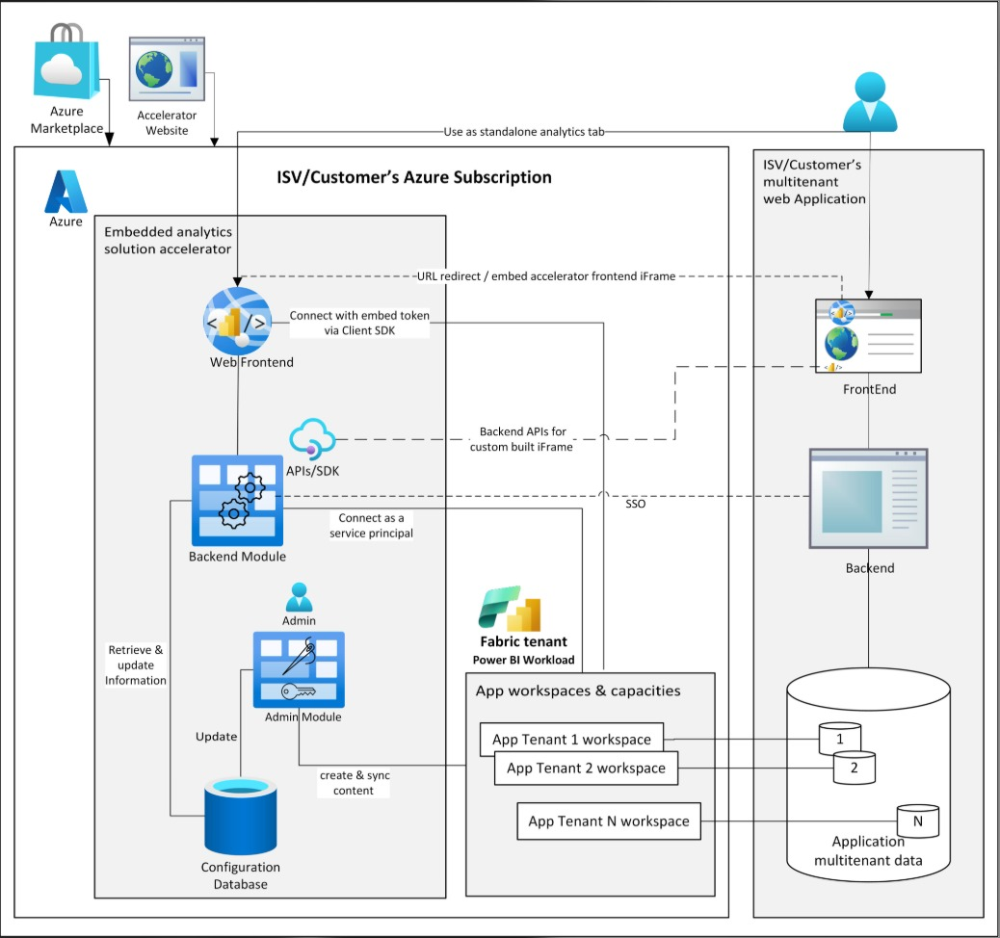

# References

## Microsoft documentation (from the architecture proposal)

| Topic | Link |
| --- | --- |
| Power BI multitenant embedding and profiles | https://learn.microsoft.com/en-us/power-bi/developer/embedded/embed-multi-tenancy |
| Import PBIX into a workspace | https://learn.microsoft.com/en-us/rest/api/power-bi/imports/post-import-in-group |
| Generate embed tokens | https://learn.microsoft.com/en-us/power-bi/developer/embedded/generate-embed-token |
| Embedded row-level security | https://learn.microsoft.com/en-us/power-bi/developer/embedded/cloud-rls |
| Azure Functions and Storage triggers | https://learn.microsoft.com/en-us/azure/azure-functions/storage-considerations |
| Azure Queue trigger | https://learn.microsoft.com/en-us/azure/azure-functions/functions-bindings-storage-queue |

## Starting points

### Embedded Analytics Solution Accelerator

Microsoft's own accelerator for exactly this shape of problem. The diagram maps closely onto the
proposed design:

| Accelerator piece | Our equivalent |
| --- | --- |
| Web Frontend | React portal |
| Backend Module (connects as a service principal) | ASP.NET Core API |
| Admin Module | The admin page the brief says is needed but not drawn |
| Configuration Database | Azure SQL |
| App workspaces & capacities — App Tenant 1..N workspace | Workspace + profile per client |
| Fabric tenant / Power BI Workload | Power BI Service on Fabric capacity |

It also shows two integration modes worth knowing about: **embed the accelerator frontend in an
iFrame** (URL redirect) or **call the backend APIs from a custom-built frontend** with SSO. The
second is what ACP wants, since the portal must be ACP-branded.

**Worth a serious look before writing code in Gate 1** — it is closer to the target design than
the App-Owns-Data Starter Kit the brief recommends, because it already has the per-tenant
workspace and profile model that the architecture review moved to.

### App-Owns-Data Starter Kit

Recommended in the 26 Oct brief as the closest existing design — database, admin app, customer
app, workspace per tenant. **Caveat from the brief itself:** it dates from 2022 (.NET 6), so use
it as a blueprint and build on current .NET.

### Other code references

| Reference | What it gives |
| --- | --- |
| PowerBI-Developer-Samples | Current embed code for .NET, Node, Python with a service principal |
| PowerBI-JavaScript (`powerbi-client`) | Library that renders the report in the page |
| `powerbi-client-react` | React wrapper for the same |
| MSAL.js | Sign-in with Entra ID in the browser |
| Microsoft.Identity.Web | Sign-in and token checks in a .NET backend |
| Service principal profiles / Create Profile API | Scaling past one service principal |
| Power BI Embedded playground | Try embed features without code |
| Microsoft Fabric pricing | Current F SKU prices per region |

## Comparable products (from the brief's market scan)

| Product | What it is | Why look |
| --- | --- | --- |
| loyos bi | Hamburg SaaS: financial management suite on Power BI (P&L, balance sheet, cash flow from DATEV, SAP, Sage) | Closest to the product idea; the partners know it |
| atSpark EmbedPortal | Ready-made multi-tenant portal on Power BI workspaces, per-client sign-in and RLS | Shows the admin and client screens a portal needs |
| DataTako | White-label Power BI portal: own logo, colours, domain | Branding and client experience; its RLS write-up |
| Star Knowledge case study | Tax and financial-planning client portal with embedded Power BI | Same audience; clients needed no Power BI licence |
| Power BI Embedded playground | Microsoft's live showcases, code open-sourced | Exactly how an embedded report looks and behaves |
| "From report to product" (Power BI Tiles blog) | Turning Power BI reports into a resellable portal | Describes the business model end to end |

Most are vendor pages — treat their claims as marketing.

## Other

- **BMAD Method** — noted in the brief as an optional way of working with AI coding agents;
  "Patrik used it for his product."

## ACP internal material (not in this repo)

- Partner page: why a Databook client portal.
- Detailed requirements (draft, paused) — 24 functional requirements and the portal data model.
  **Worth retrieving before the implementation plan**: a paused requirements draft with a data
  model is directly reusable.
